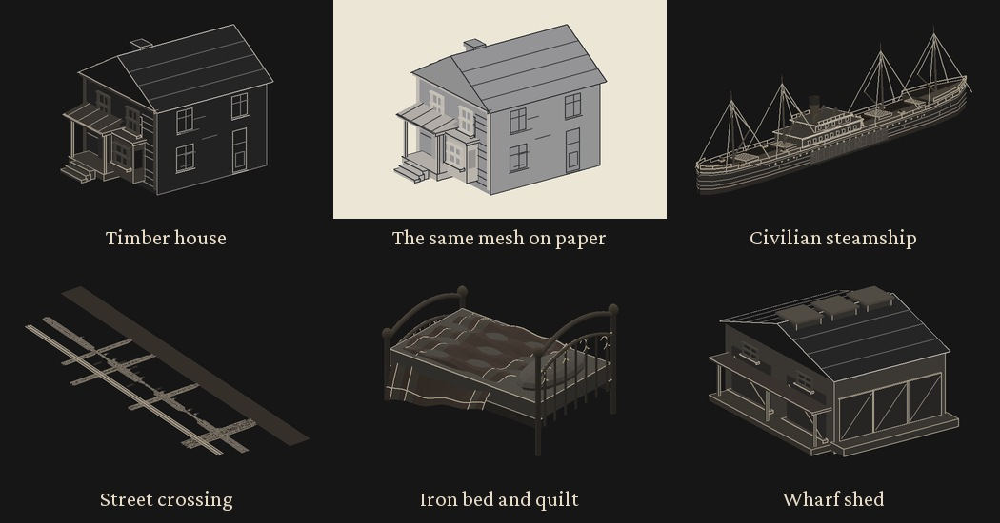

# Original location and prop library

These eight original architectural and prop meshes were built for the Halifax production and exported independently from its scene geometry. They are released here under MIT. Each GLB carries local mesh geometry, base-centred metre coordinates (glTF Y-up), vertex pigments and line primitives. There are no embedded photographs or linked texture files. Edit them in Blender or render the original face and line layers with [model_view.py](../../scripts/model_view.py).

| Model | What to reuse |
| --- | --- |
| [Timber house](timber-house.glb) | Residence, side and rear elevation, roof and porch; inspect the eventual camera angle. |
| [Street crossing](street-crossing.glb) | Road and goods tracks; use them to register buildings and give the camera a fixed ground reference. |
| [Suspended streetlight](suspended-lamp.glb) | Street furnishing, attachment and scale cue. |
| [Iron bed and quilt](iron-bed.glb) | Interior anchor with distinct rails, headboard and covering. |
| [Wharf shed](wharf-shed.glb) | Waterfront, roof, loading face and bays. |
| [Winter cottage](winter-cottage.glb) | Shelter, doorway and an intact recurring landmark. |
| [Bench](bench.glb) | Human-scale street furniture. |
| [Civilian steamship](steamship.glb) | Historical Imo reconstruction; hull, superstructure, funnel, deck and rigging. Establish the scale of any new scene independently. |

Example commands from the repository root:

~~~sh
python skills/mtake-davinci/scripts/model_view.py skills/mtake-davinci/assets/models/timber-house.glb build/house-dark.png
python skills/mtake-davinci/scripts/model_view.py skills/mtake-davinci/assets/models/timber-house.glb build/house-light.png --theme light
~~~

The two commands keep the camera fixed while changing the treatment. Set --azimuth and --elevation in degrees to inspect the sides the planned move reveals. The compact viewer reads the original library GLB layout. Blender is the general importer for other authors' meshes. These models are production starting points. For a specific new location, match a real photo, rear elevation and street layout to the story before locking that shot.
